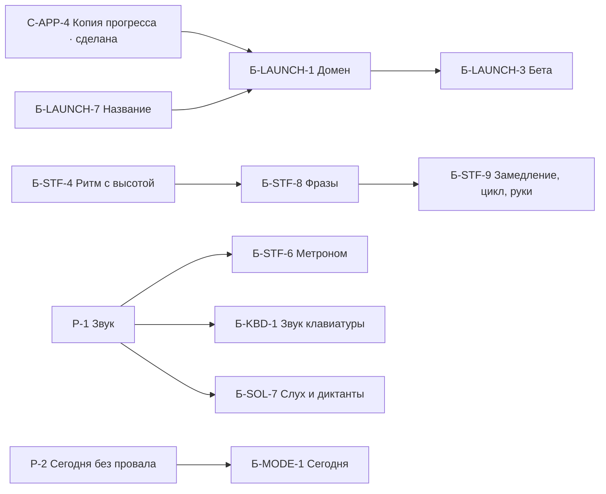
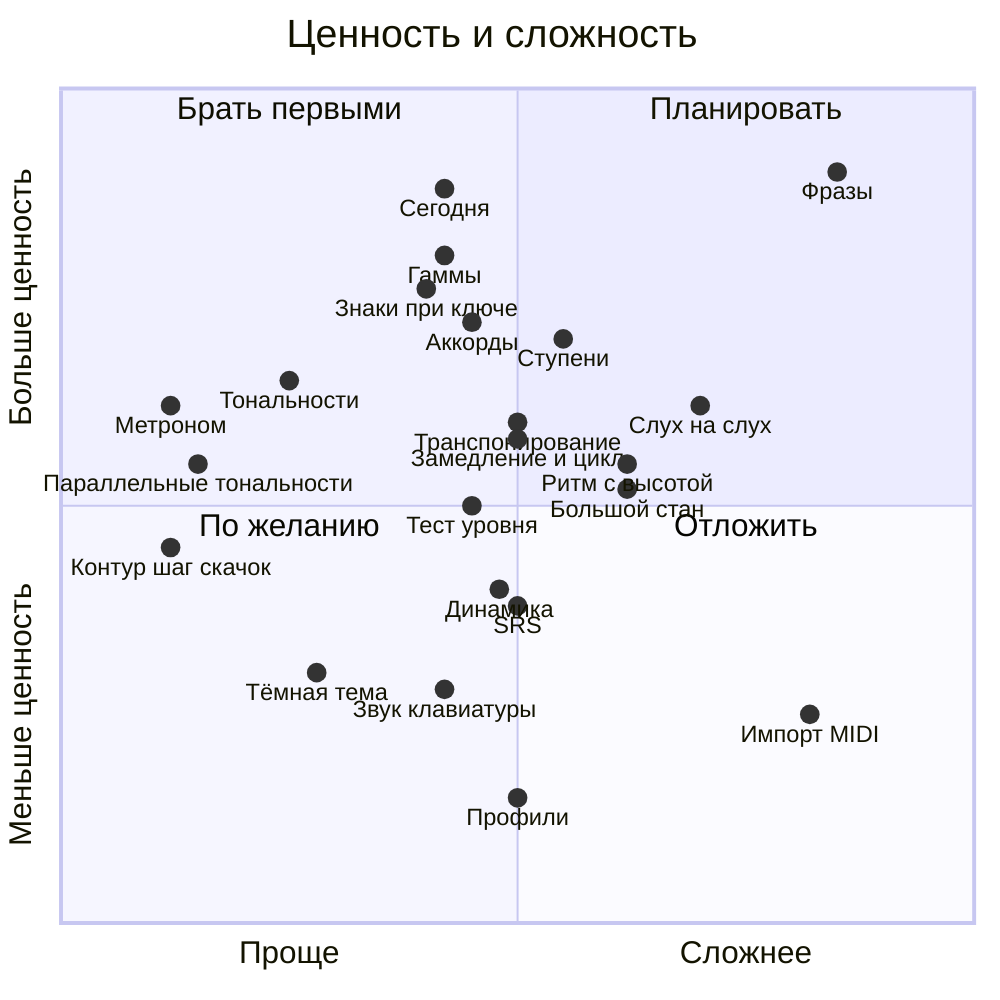

# Беклог идей

> **Назначение:** единственный список того, что можно взять в работу. Без дат и без порядка: что брать
> следующим, владелец решает, когда берёт. Заменяет дорожную карту (удалена 30.10.2026, всё нужное
> перенесено сюда) и разделы «Беклог» в паспортах модулей.
> **Нормативно ли:** нет. Это идеи, а не требования. Решения и числа фиксируются в спецификации
> `C-XX-N`, когда идею берут в работу.

## Как пользоваться

**Взять идею.** Выбрать строку → статус «взята, `C-XX-N`» → дальше обычный процесс из
`PSD/README.md` (`spec/…` → `apply/…`). Когда спецификация закрыта (архивация change'а), статус
меняется на «сделана, `C-XX-N`» и строка переезжает в раздел «Сделано».

**Добавить идею.** Новая строка в таблице модуля, следующий свободный номер `Б-<модуль>-N`.
Сюда же попадает всё, что спецификация вынесла «Вне Scope» как «потом», и доработки закрытых
спецификаций, которые пока никто не взял.

**Номера не переиспользуются.** На `Б-XX-N`, пункты бывшей дорожной карты и решения `Р-n` из этого
файла ссылаются закрытые спецификации, а их текст больше не меняется. Отклонённая идея остаётся
со статусом «отклонена» и причиной.

| Статус | Что значит |
|---|---|
| идея | Можно брать |
| взята, `C-XX-N` | Есть спецификация, идёт работа |
| сделана, `C-XX-N` | Спецификация закрыта, строка в разделе «Сделано» |
| отклонена | Не делаем; причина в описании |

| Размер | Что это |
|---|---|
| S | Один небольшой цикл `spec → apply` |
| M | Один полноценный цикл |
| L | Несколько циклов |
| XL | Не по ресурсам, не берём |

Ценность — для владельца-ученика с учётом публичного запуска: высокая, средняя, низкая. У идей,
которых не было в дорожной карте, размер и ценность — первичная оценка, владелец её правит.

## Идеи

### `M-STF` · Нотный стан и упражнения

| ID | Идея | Размер | Ценность | Зависит от | Статус |
|---|---|---|---|---|---|
| `Б-STF-1` | Интервальные повторения (SRS) | M | низкая | — | идея |
| `Б-STF-2` | Мягкий / жёсткий таймер | S | низкая | — | идея |
| `Б-STF-3` | «Контур»: шаг / скачок | S | средняя | — | идея |
| `Б-STF-4` | Ритм вместе с высотой | M–L | средняя | — | идея |
| `Б-STF-5` | Предпросмотр настроек «Разминки» на компактном экране | M | низкая | — | идея |
| `Б-STF-6` | Метроном | S | средняя | Р-1 (звук) | идея |
| `Б-STF-7` | Тональности в «Последовательностях» | S–M | средняя | — | идея |
| `Б-STF-8` | Генерируемые фразы для чтения с листа | L | высокая | `Б-STF-4` | идея |
| `Б-STF-9` | Замедление, цикл, отдельные руки | M | средняя | `Б-STF-8` | идея |
| `Б-STF-10` | Динамика по velocity («играй ровно») | M | низкая | — | идея |
| `Б-STF-11` | Тест уровня чтения | M | средняя | — | идея |
| `Б-STF-12` | Большой стан (обе руки) | M–L | средняя | — | идея |
| `Б-STF-13` | Импорт MIDI | L | низкая | живой запрос пользователей | идея |

### `M-SOL` · Сольфеджио

| ID | Идея | Размер | Ценность | Зависит от | Статус |
|---|---|---|---|---|---|
| `Б-SOL-1` | «Интервалы»: выбор отдельных интервалов, басовый ключ, чёрная клавиша как первая нота | S–M | низкая | — | идея |
| `Б-SOL-2` | «Длительности»: такт с пропущенной нотой | M | средняя | — | идея |
| `Б-SOL-3` | Режим «Знаки при ключе» | M | высокая | — | идея |
| `Б-SOL-4` | Режим «Параллельные тональности» | S | средняя | — | идея |
| `Б-SOL-5` | Режим «Ступени» (включая опевание) | M–L | высокая | таблица правил, сверенная владельцем | идея |
| `Б-SOL-6` | Режим «Гаммы вперёд и назад» | M | высокая | — | идея |
| `Б-SOL-7` | Слух и диктанты | M + M, диктанты L | средняя | Р-1 (звук) | идея |
| `Б-SOL-8` | Режим «вперемешку» | M | средняя | — | идея |
| `Б-SOL-9` | «Длительности»: точки | S | низкая | — | идея |
| `Б-SOL-10` | Чтение аккордов (трезвучия, обращения) | M | высокая | — | идея |
| `Б-SOL-11` | Режим «Транспонирование» | M | средняя | — | идея |
| `Б-SOL-12` | Пение с листа по микрофону | L | низкая | — | идея, отложена |

### `M-MODE` · Режимы

| ID | Идея | Размер | Ценность | Зависит от | Статус |
|---|---|---|---|---|---|
| `Б-MODE-1` | «Сегодня»: 5–10 заданий из трудных мест и счётчик дней без «сгорания» | M | высокая | Р-2 | идея |

### `M-APP` · Приложение

| ID | Идея | Размер | Ценность | Зависит от | Статус |
|---|---|---|---|---|---|
| `Б-APP-1` | Тёмная тема | S–M | низкая | — | идея |
| `Б-APP-2` | Фотографии подключения пианино в подсказке | S | низкая | — | идея |
| `Б-APP-3` | Быстрое скрытие экранной клавиатуры на главном экране | S | низкая | — | идея |
| `Б-APP-4` | Тесный ряд кнопок на 960–1100 px | S–M | средняя | — | идея |
| `Б-APP-5` | Профили учеников | M | низкая | — | идея |

### `M-KBD` · Экранная клавиатура

| ID | Идея | Размер | Ценность | Зависит от | Статус |
|---|---|---|---|---|---|
| `Б-KBD-1` | Звук экранной клавиатуры | M | низкая | Р-1 (звук) | идея |

### `M-LAUNCH` · Публичный запуск

Волны запуска и их жёсткий порядок — в паспорте `M-LAUNCH`: это зависимости, а не график.

| ID | Идея | Размер | Ценность | Зависит от | Статус |
|---|---|---|---|---|---|
| `Б-LAUNCH-1` | Домен и деплой | M–L | высокая | `C-APP-4` (сделана), `Б-LAUNCH-7` | идея |
| `Б-LAUNCH-2` | «О приложении» и сведения для поддержки | S | высокая | — | идея |
| `Б-LAUNCH-3` | Закрытая бета на чужом железе | L | высокая | `Б-LAUNCH-1` | идея |
| `Б-LAUNCH-4` | Первый запуск | M | средняя | — | идея |
| `Б-LAUNCH-5` | Магазины (RuStore, Google Play) | L | низкая | волна 2 запуска | идея |
| `Б-LAUNCH-7` | Название | S | высокая | — | идея |
| `Б-LAUNCH-8` | Приложение на других языках | S на язык | средняя | — | идея |

## Зависимости

Только технические связи. Порядок работы они не задают: брать можно любую идею, у которой
зависимости уже сделаны.

## Ценность и сложность

Подсказка для выбора. Позиции — оценки из бывшей дорожной карты.

## Описание идей

Описание помогает вспомнить, о чём шла речь. Это не спецификация: решения и числа фиксируются в
`C-XX-N`.

### `M-STF`

**`Б-STF-1` Интервальные повторения (SRS).** Вместо простых весов по трудности — расписание
повторений: освоенное реже, забытое чаще. Зачем: единственная доказанная часть механики Дуолинго.
Как: заменить веса в `practice-stats` на расписание; нужна миграция статистики без потери данных.
Эффект виден через месяцы.

**`Б-STF-2` Мягкий / жёсткий таймер.** Ученик играет в своём темпе; таймер — возможная опция.
Риск: спорит с принципом «в своём темпе», поэтому только по выбору ученика.

**`Б-STF-3` «Контур»: шаг / скачок.** В режиме «Контур» кроме направления (вверх, вниз, на месте)
различать секунду и более широкие интервалы. Зачем: следующий уровень режима (`C-STF-5`). Как:
логика контура уже считает направление; добавить порог размера интервала и один ответ из трёх
вариантов. Риск минимальный.

**`Б-STF-4` Ритм вместе с высотой.** «Последовательности» с ритмом: ученик играет правильные ноты
с правильной длительностью. Зачем: мост от упражнений к фразам. Как: объединить `C-STF-2` и
`C-STF-6`; нужна запись длительностей.

**`Б-STF-5` Предпросмотр настроек «Разминки» на компактном экране.** Два стана с 23 нотами на
телефоне (740×360) нечитаемы; нужна адаптация (`C-STF-9`, Р-20).

**`Б-STF-6` Метроном.** Тихий щелчок в такт в режиме «Ритм» (и, по желанию, в других режимах).
Зачем: ритм проще держать с опорой. Как: Web Audio, без загрузки файлов; громкость и частота
настраиваются. Риск: первый звук в проекте, а `M-KBD` звук исключает — нужно решение Р-1. По
умолчанию метроном выключен и обратного отсчёта нет, чтобы не нарушать принцип «в своём темпе».

**`Б-STF-7` Тональности в «Последовательностях».** Ноты последовательности строятся в выбранной
тональности со знаками при ключе. Зачем: читать надо не только в до мажоре. Как: подключить
движок знаков из `C-STF-9`. Частично пересекается с `Б-SOL-3`.

**`Б-STF-8` Генерируемые фразы для чтения с листа.** Короткие мелодии с ритмом, которые
приложение генерирует само, а не хранит. Зачем: самая «потоковая» идея, к ней ведёт принцип
«читаем потоком». Как: генератор мелодий по правилам (ступенчатое движение, ограниченные скачки,
тональность), показ на стане, оценка нот и ритма.

**`Б-STF-9` Замедление, цикл, отдельные руки.** Работает только поверх фраз: сыграть фразу в
замедленном темпе, закольцевать трудный такт, отработать каждую руку отдельно. Зачем: инструменты
разучивания пьес, у лидеров рынка они есть. Как: один движок воспроизведения фраз с множителем
темпа, диапазоном тактов и выбором руки.

**`Б-STF-10` Динамика по velocity.** Упражнение «играй ровно» (одинаковая громкость в
последовательности) или «тише / громче». Зачем: у конкурентов динамику оценивает только ROLI и
только с камерой, а velocity у нас уже приходит из MIDI. Как: считать разброс velocity в серии
нажатий и показывать крупно.

**`Б-STF-11` Тест уровня чтения.** Фиксированный набор заданий, итог — уровень. Зачем: аналог
SASR из Piano Marvel, ученик видит рост за месяцы. Как: набор из существующих режимов, шкала
уровней, результат сохраняется в прогрессе.

**`Б-STF-12` Большой стан.** Обе руки на двух станах сразу. Зачем: настоящая игра двумя руками.
Как: VexFlow умеет; сложнее генератор и проверка двух рук.

**`Б-STF-13` Импорт MIDI.** Загрузка своего MIDI-файла и чтение его нот. Риск: квантование,
разделение голосов, вёрстка на стане. Только если появится живой запрос. MusicXML (XL) не берём.

### `M-SOL`

Общие правила для всех режимов — в разделе «Общие правила режимов `M-SOL`» ниже.

**`Б-SOL-1` «Интервалы»: доработки.** Выбор отдельных интервалов, басовый ключ, чёрная клавиша как
первая нота. Вне Scope `C-SOL-2`.

**`Б-SOL-2` «Длительности»: такт с пропущенной нотой.** Один такт с заданным размером (2/4, 3/4,
4/4, 6/8), несколько нот и пауз, одного элемента не хватает в любом месте такта; ученик называет
длительность недостающей. Как: генератор разбивает такт на длительности и скрывает одну. Нужно
гарантировать, что скрытое значение выражается одной нотой, в том числе с точкой (чтобы не
получилось 5/8 в 6/8). Скрытый элемент показывается акцентным вопросом, место в такте сохраняется.

**`Б-SOL-3` Режим «Знаки при ключе».** Система пишет название мажора или минора, ученик играет
нужные диезы или бемоли чёрными клавишами в правильном порядке. Порядок диезов: фа, до, соль, ре,
ля, ми, си; бемолей — си, ми, ля, ре, соль, до, фа. Шестой и седьмой знак приходятся на белые
клавиши (ми♯ = фа, си♯ = до; до♭ = си, фа♭ = ми), поэтому на первом уровне не больше пяти знаков
(Р-8), шесть и семь — позже с пояснением. Вариации: название тональности словами или знаки на
стане; обратная задача: показаны знаки, ученик играет тонику. Названия тональностей зависят от
языка интерфейса (до мажор, C major). Опирается на движок знаков из `C-STF-9`.

**`Б-SOL-4` Режим «Параллельные тональности».** Система пишет тональность словами (мажорную),
ученик одной клавишей нажимает тонику параллельной минорной, и наоборот. Зачем: быстрое
закрепление связи знаков при ключе. Ограничение: энгармонические пары (фа♯ мажор и соль♭ мажор)
нажатием не различить, поэтому принимаем любое написание. На экранной клавиатуре диапазон
ограничен большой октавой.

**`Б-SOL-5` Режим «Ступени».** Система пишет гамму и список ступеней, ученик нажимает их на
клавиатуре в нужном порядке. Знак при ключе учитывается: если в тональности фа♯, верна чёрная
клавиша, а не белая. Задания:
- тоническое трезвучие (I, III, V);
- устойчивые ступени (I, III, V);
- неустойчивые ступени (II, IV, VI);
- вводные ступени;
- опевание устойчивых ступеней: для заданной устойчивой ступени ученик нажимает две вводные к ней,
  нижнюю и верхнюю (например, в до мажоре для ступени до это си и ре) [?предположение: сверить
  формулировку и порядок нажатий с тетрадью].

Риск: «вводные» зависят от вида минора (в натуральном седьмая ступень не вводная, в гармоническом
вводная), поэтому таблицу правил владелец сверяет с учебной теорией, а не пишем по памяти.

**`Б-SOL-6` Режим «Гаммы вперёд и назад».** Система показывает мажорную или минорную гамму и её
вид (натуральный, гармонический, мелодический); ученик играет её вверх и вниз по памяти. Ошибки
показываются только после проигрыша: неверная нота красным, как было нужно — зелёным. Конец ввода
определяется фиксированным числом нот (8 вверх и 7 вниз). Первую ноту принимаем в любой октаве,
остальные оцениваем относительно неё. Мелодический минор («вверх иначе, чем вниз») хорошо
проверяет знание, а не угадывание. До 30.10.2026 `Б-SOL-6` включала и транспонирование; оно
выделено в `Б-SOL-11`.

**`Б-SOL-7` Слух и диктанты.** Слух: приложение проигрывает интервал или аккорд, ученик называет
или играет его. Зачем: настоящее сольфеджио начинается со слуха. Как: нужен звук (Р-1) и сэмплы;
генератор тот же, что в `M-SOL`. Размер M + M за звук. Диктанты (слуховой, ритмический):
приложение играет фразу, ученик записывает её игрой. Размер L, после слуха.

**`Б-SOL-8` Режим «вперемешку».** Задания из нескольких выбранных режимов сольфеджио в одной
сессии; настройки берутся у каждого режима (`C-SOL-1`, Р-21). Имеет смысл, когда готовы хотя бы
два режима — условие уже выполнено.

**`Б-SOL-9` «Длительности»: точки.** Чёрная клавиша справа от белой = та же длительность с
точкой; клавиши ля, си и чёрные уже оставлены в резерве (`C-SOL-3`, приложение Д).

**`Б-SOL-10` Чтение аккордов.** Название аккорда или его запись на стане: ученик играет
трезвучие, обращение. Зачем: основа гармонии, для Simply Piano это целая ветка курса. Как: шаги из
нескольких нот в «Последовательностях» уже есть; не хватает названий аккордов, обращений и
генератора.

**`Б-SOL-11` Режим «Транспонирование».** В дорожной карте была только строкой таблицы, без
описания. Суть и правила проверки уточняются при спецификации.

**`Б-SOL-12` Пение с листа по микрофону.** Распознавание высоты голоса. Отложено: на фальшивящем
голосе много ложных «неверно», надёжность хуже, чем у MIDI.

### `M-MODE`

**`Б-MODE-1` «Сегодня».** Один экран и одна кнопка: приложение смешивает 5–10 коротких заданий из
разных режимов по слабым местам и показывает, что стало лучше. Счётчик «занимался N дней» без
серии, которая сгорает, и без наказаний. Зачем: привычка. Как: собирается из `practice-stats` и
режимов.

Про механику «5–10 заданий в день, как в Дуолинго»: сомнения владельца в её эффективности
обоснованы — у Дуолинго работает привычка, а не обучение. Доказанная часть — повторение с
разнесением и мгновенная обратная связь (`Б-STF-1`), а группировка в «уроки-плитки» — упаковка.
Решение: в каждом режиме сессия = N заданий, как сейчас в «Последовательностях»; «Сегодня»
смешивает задания разных режимов без жёстких уровней и без наказания за пропуск. Через месяц
владелец сам оценит, помогает ли.

### `M-APP`

**`Б-APP-1` Тёмная тема.** Вторая палитра. Зачем: удобство вечером. Риск: контраст AAA придётся
проверять заново; светлая «бумага» остаётся основной (CLAUDE.md §6).

**`Б-APP-2` Фотографии подключения пианино в подсказке.** Механизм изображений готов (`C-APP-2`),
снимков пока нет.

**`Б-APP-3` Быстрое скрытие экранной клавиатуры на главном экране.** Флажок в ряду кнопок не
помещается (замер на 1280×720 в режимах с двумя флажками); варианты — подписанная кнопка в блоке
клавиатуры или верхняя панель (`C-APP-5`, Р-18).

**`Б-APP-4` Тесный ряд кнопок на 960–1100 px.** Ряд с двумя флажками переносится, зона нот
сжимается до 30–95 px (`C-APP-5`, Р-20).

**`Б-APP-5` Профили учеников.** Несколько учеников на одном планшете, у каждого свой прогресс.
Зачем: семья. Риск: миграция хранилища в `.v2`, это угроза данным владельца (CLAUDE.md §7).
Делать последним.

### `M-KBD`

**`Б-KBD-1` Звук экранной клавиатуры.** Нажатие клавиши на экране издаёт звук пианино. Зачем: для
тех, у кого нет пианино. Как: сэмплы 1–3 МБ в оффлайн-кеш, Web Audio. Нужно решение Р-1.

### `M-LAUNCH`

**`Б-LAUNCH-1` Домен и деплой.** Лендинг на `/`, приложение на `/app/` (меняется `base` в
`vite.config.ts`, адрес манифеста и `start_url`). Статика на немецком VPS (nginx + Let's Encrypt),
копия на российском VPS через `rsync`, `ru.`-адрес или GeoDNS. Деплой — GitHub Actions. Старый
адрес на GitHub Pages остаётся рабочим, пока владелец не перенёс данные; потом на нём —
переадресация с подсказкой «мы переехали». Нужна спецификация: меняется видимый адрес и установка
PWA. На новый домен не переезжаем до `C-APP-4` (потеря прогресса — худший сценарий, CLAUDE.md §7);
`C-APP-4` уже сделана.

**`Б-LAUNCH-2` «О приложении».** В «Настройках» или отдельным экраном: версия, лицензии (VexFlow —
MIT, Bravura — SIL OFL, React — MIT; текст лицензий лежит в сборке), контакт, «Скопировать
сведения для поддержки» (версия, браузер, список MIDI-входов, состояние связи — без нот и
прогресса). Это замена телеметрии: ученик сам присылает владельцу то, что нужно.

**`Б-LAUNCH-3` Закрытая бета.** Матрица совместимости: пианино (Yamaha, Casio, Roland, Korg…),
устройства (планшет с OTG, телефон, Windows, macOS, Linux), версии Chrome. Что считаем
«работает»: связь после сна, переподключение кабеля, отклик ≤ 50 мс. Если проверка MIDI на чужом
железе кажется срочнее новых упражнений, бету можно брать раньше: приоритет №1 — надёжность.
Внешние задачи (люди, чужое железо) не ускоряются Claude Code и идут по календарю.

**`Б-LAUNCH-4` Первый запуск.** Что видит человек, который не знает приложения: приглашение
«Подключи пианино кабелем или нажми «Старт» и играй на экранной клавиатуре». Экранная клавиатура
уже позволяет попробовать без пианино. Нужна спецификация.

**`Б-LAUNCH-5` Магазины.** Google Play с территории РФ недоступен для регистрации разработчика
(оплата и аккаунт). RuStore — основной путь. Оболочка TWA требует `assetlinks.json` на корне
домена.

**`Б-LAUNCH-7` Название.** «Нотный тренажёр» — общее слово, найти в поиске трудно; репозиторий
`piaono_app`. Нужно уникальное имя и свободный домен до домена и лендинга (Р-4).

**`Б-LAUNCH-8` Приложение на других языках.** Перевод интерфейса на немецкий, испанский,
французский, китайский — чтобы сайт на этих языках вёл в приложение на том же языке. До этого сайт
честно пишет «тренажёр пока на английском» (`C-LAUNCH-1`, INV-2). Через `C-APP-3`: один файл на
язык.

## Общие правила режимов `M-SOL`

Режимы — авторская интерпретация владельца: обобщённые и доработанные задачи, которые он сам решал
вручную в рабочей тетради по сольфеджио. Конкретных задач и заданий тетради в приложении нет,
только идеи. Главная ценность — автоматическая проверка, которой нет у бумажной тетради. Звук для
этих режимов не нужен: ответ играется на пианино или касанием экрана.

Правила ниже уже реализованы в ядре (`C-SOL-1`, `openspec/specs/solfege-tasks`); здесь они для
новых режимов.

- Каждая идея — отдельный режим, вариации выбираются в настройках режима.
- Один ответ = одно нажатие: оценка сразу. Ответ = несколько нажатий (гамма, транспонирование):
  оценка после последней ноты, неверная нота красным, как надо — зелёным.
- Ответ-нота засчитывается только той высоты, что на нотном стане, с октавой. Ответ «клавиша =
  значение» (по легенде) засчитывается в любой октаве. На экранной клавиатуре вместо блокировки
  прокрутки — авто-сдвиг по диапазону задания (механизм из `C-STF-9`).
- Для ответов «клавиша = значение» над клавишами показывается легенда, и она помещается в рабочую
  зону, потому что на компактном экране (`C-APP-5`) экранной клавиатуры нет.
- Статистика стандартная: угадал сразу, угадал не сразу, не угадал; самые трудные задания; ключ
  статистики — тип задания.
- Терминология: «размер» в тетради означает длительность ноты, а размер — это 2/4, 3/4 и так далее;
  «противоположные тональности» — это параллельные; «первая и вторая октава» — русская нумерация, а
  приложение называет ноты по-научному (C4), поэтому в подсказке нужна таблица соответствия.

## Сделано

| Идея | Что сделано |
|---|---|
| Общее ядро заданий сольфеджио (п. 17 дорожной карты) | `C-SOL-1` |
| Режим «Интервалы» (п. 18) | `C-SOL-2` |
| Режим «Длительности» (п. 19) | `C-SOL-3` |
| Ключи, тональности, бекар в «Разминке» | `C-STF-9` |
| Язык приложения | `C-APP-3` |
| Компактный экран | `C-APP-5` |
| Резервная копия прогресса | `C-APP-4` |

## Отклонено

| ID | Идея | Причина |
|---|---|---|
| `Б-LAUNCH-6` | Счётчик посещений без скриптов | Решение владельца 03.10.2026: на сайте — Яндекс Метрика (`C-LAUNCH-1`, Р-2), в приложении аналитики нет |

## Не делаем

| Что | Причина |
|---|---|
| Микрофон для акустики | Хуже MIDI по надёжности; приоритет №1 — надёжность |
| Падающие ноты | Антипаттерн рынка, противоречит принципу «читаем потоком» |
| Курсы, видео рук, библиотека песен | Нужны методист и лицензии |
| Камера, AI-коуч, голос | Высокая цена; противоречит «всё локально» |
| Лиги, рейтинги, аккаунты, семейные тарифы | Противоречит CLAUDE.md §1 |
| Режим учителя | Лёгкая замена: ученик присылает файл копии из `C-APP-4` |
| Подсветка клавиш пианино | Зависит от модели, нужны sysex-команды |
| Импорт MusicXML | XL: произвольная вёрстка партитур |
| Задания из тетради «как есть» | Авторское право: переносим типы заданий, а не конкретные задачи; правила в подсказках пишем своими словами |

## Решения владельца

Номера перенесены из дорожной карты без изменений: на них ссылаются закрытые спецификации
(`C-SOL-1`: «решение Р-1 „Дорожной карты“»).

| # | Вопрос | Рекомендация | Статус |
|---|---|---|---|
| Р-1 | Разрешить ли приложению звучать? | Да, опционально, по умолчанию выключено | открыт; блокирует `Б-STF-6`, `Б-KBD-1`, `Б-SOL-7` |
| Р-2 | «Сегодня» и счётчик дней — совместимы ли с принципом «без провала»? | Да, если серия не сгорает | открыт; блокирует `Б-MODE-1` |
| Р-3 | Порядок: сначала упражнения или сначала публичный запуск? | — | снят 30.10.2026: порядка больше нет, владелец выбирает идею из беклога |
| Р-4 | Новое имя | Выбрать до домена | открыт; это `Б-LAUNCH-7`, блокирует `Б-LAUNCH-1` |
| Р-5 | Платформа донатов | Решить при работе над лендингом; ссылка без кода | открыт |
| Р-6 | Сольфеджио начинается с общего ядра и режима «Интервалы» | — | принято 04.10.2026, сделано (`C-SOL-1`, `C-SOL-2`) |
| Р-7 | Любая октава на настоящем пианино, авто-сдвиг на экране вместо блокировки прокрутки | — | принято 04.10.2026, сделано (`C-SOL-1`) |
| Р-8 | Знаки при ключе: до пяти знаков на первом уровне | — | принято 04.10.2026; для `Б-SOL-3` |
| Р-9 | Фото страниц тетради по каждому типу заданий | Не нужны: режимы — интерпретация владельца, а не задачи тетради (`C-SOL-1`, Р-12) | закрыт |

## Приложение А. Пункты дорожной карты → ID

Закрытые спецификации ссылаются на «Дорожную карту, п. N». Где теперь этот пункт:

| П. | Идея | ID |
|---|---|---|
| 1 | Метроном | `Б-STF-6` |
| 2 | «Контур»: шаг / скачок | `Б-STF-3` |
| 3 | Тональности в «Последовательностях» | `Б-STF-7` |
| 4 | «Сегодня» | `Б-MODE-1` |
| 5 | Чтение аккордов | `Б-SOL-10` |
| 6 | Ритм вместе с высотой | `Б-STF-4` |
| 7 | Генерируемые фразы | `Б-STF-8` |
| 8 | Замедление, цикл, отдельные руки | `Б-STF-9` |
| 9 | Динамика по velocity | `Б-STF-10` |
| 10 | Тест уровня чтения | `Б-STF-11` |
| 11 | SRS | `Б-STF-1` |
| 12 | Большой стан | `Б-STF-12` |
| 13 | Тёмная тема | `Б-APP-1` |
| 14 | Звук экранной клавиатуры | `Б-KBD-1` |
| 15 | Профили учеников | `Б-APP-5` |
| 16 | Импорт MIDI | `Б-STF-13` |
| 17 | Общее ядро заданий | сделано, `C-SOL-1` |
| 18 | Режим «Интервалы» | сделано, `C-SOL-2` |
| 19 | Режим «Длительности» | сделано, `C-SOL-3` |
| 20 | Такт с пропущенной нотой | `Б-SOL-2` |
| 21 | Знаки при ключе | `Б-SOL-3` |
| 22 | Параллельные тональности | `Б-SOL-4` |
| 23 | Ступени | `Б-SOL-5` |
| 24 | Гаммы вперёд и назад | `Б-SOL-6` |
| 25 | Транспонирование (в таблице); механика «как в Дуолинго» (в описании) | `Б-SOL-11`; описание механики — в `Б-MODE-1` |
| 26 | Слух: интервал или аккорд на слух | `Б-SOL-7` |
| 27 | Диктанты | `Б-SOL-7` |
| 28 | Пение с листа по микрофону | `Б-SOL-12` |

## Приложение Б. Исследование рынка (октябрь 2026)

Цель проекта: закрыть собственные потребности обучения, затем по возможности открыть тренажёр
другим. Конкурировать с Simply Piano и другими не нужно, монетизации и продвижения нет (максимум
ссылка на донаты и страница-лендинг).

**Главное:**
- Наши сильные стороны, которые у конкурентов слабые: чтение нот без «падающих нот», оффлайн,
  никаких подписок и аккаунтов, русский язык.
- Доступность (крупно, контрастно, без тонких линий) в исследовании не упомянута ни у одного из
  девяти приложений. Это главный тезис лендинга.
- Фичи разучивания пьес (замедление, цикл, отдельные руки) нужны только после появления пьес или
  фраз.
- Сольфеджио на рынке: слух и интервалы покрыты хорошо (EarMaster, Perfect Ear, Functional Ear
  Trainer), российская школа сольфеджио с ответом игрой на пианино и крупным интерфейсом покрыта
  слабо. Это не рыночная ниша, а удобное совпадение: тренажёру нужна именно такая практика.

**Сольфеджио и слух.** Источники — обзоры и страницы магазинов, приложения руками не проверялись.

| Приложение | Что покрывает |
|---|---|
| [EarMaster](https://earmaster.com/products/ear-training-sight-singing/earmaster-software.html) | Самое полное: интервалы, аккорды, диктанты, пение с листа; голос и хлопки, MIDI. Школьная версия, около 4000 уроков, примерно $5–24 в год на ученика |
| [Perfect Ear, Functional Ear Trainer](https://musiciangoods.com/blogs/music-theory/best-ear-training-apps) | Слух, теория, ритм; Perfect Ear бесплатно |
| Skoove | Теория, чтение с листа и слух внутри уроков; единственный из лидеров по пианино с явным слухом |
| Yousician | Теория и тренажёры; учитель может назначить упражнения на слух |
| Simply Piano | Упор на песни, теории и слуха мало |
| [«Мое сольфеджио»](https://www.rustore.ru/catalog/app/com.solfeggio.app), [«Слухачъ»](https://www.rustore.ru/catalog/app/com.slukhach.slukhach.free) | Локальные приложения RuStore: ноты в ключах, тональности, интервалы с ответом на клавиатуре; у первого тренировка снова на падающих нотах |
