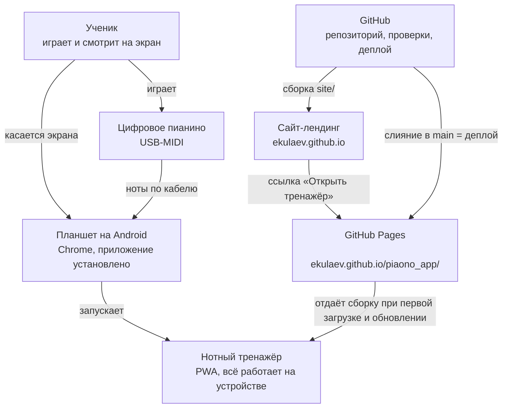

# C1. Контекст

Кто пользуется тренажёром и с чем он связан снаружи.

## Участники

| Кто / что | Роль |
|---|---|
| **Ученик** | Единственный пользователь. Занимается каждый день, на планшете — его настройки и прогресс |
| **Цифровое пианино** | Источник нот. Подключено к планшету кабелем USB-MIDI. Звук — у самого пианино, приложение не звучит |
| **Планшет** | Android, Chrome, ландшафт. Без пианино можно играть на экранной клавиатуре; на телефоне и маленьких окнах — только с пианино (`C-APP-5`) |
| **GitHub Pages** | Хостинг сборки по HTTPS (без HTTPS Chrome не даёт Web MIDI). После первой загрузки нужен только для обновлений |
| **GitHub** | Код, проверки на каждом PR, деплой при слиянии в `main` |
| **Сайт-лендинг** | Публичная страница о тренажёре, отдельный репозиторий `ekulaev.github.io`, исходники в `site/` (`C-LAUNCH-1`, в работе) |

## Чего снаружи нет

Серверов, аккаунтов, аналитики, внешних API, базы данных (CLAUDE.md §1). Всё, что приложение
знает об ученике, лежит в `localStorage` планшета. Перенести данные на другое устройство можно
только файлом резервной копии (`C-APP-4`). Счётчик Яндекс Метрики есть только на сайте-лендинге.
