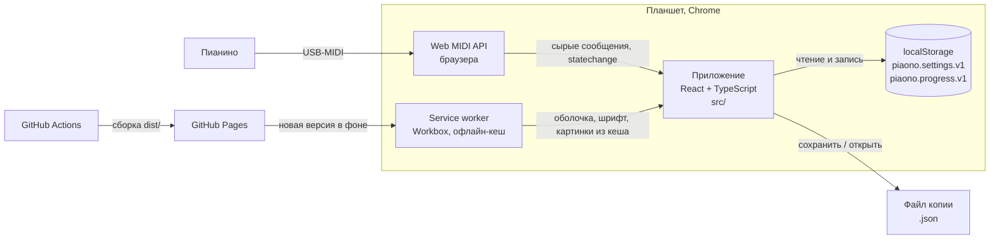

# C2. Контейнеры

Из каких работающих частей состоит тренажёр. «Контейнер» в C4 — это не Docker, а отдельно
работающая часть: приложение в браузере, service worker, хранилище, сборка.

## Части

| Часть | Технологии | Что делает | Где в репозитории |
|---|---|---|---|
| **Приложение** | React 19, TypeScript, Vite; VexFlow 5 со шрифтом Bravura | Весь тренажёр: MIDI, упражнения, экраны. Одна страница, один экран без скролла | `src/`, вход — `src/main.tsx`, корень — `src/ui/App.tsx` |
| **Service worker** | `vite-plugin-pwa` (Workbox, `generateSW`) | Кладёт всю сборку в кеш устройства: после первой загрузки приложение работает без сети. Новую версию скачивает в фоне и ждёт кнопки «Обновить» или следующего запуска (`registerType: 'prompt'`) | `vite.config.ts`, `src/ui/useAppUpdate.ts` |
| **localStorage** | Хранилище браузера | Настройки и прогресс ученика, два ключа | Доступ только через `src/storage/` ([Данные](<Данные.md>)) |
| **Web MIDI API** | Браузерный API Chrome | Доступ к пианино, список входов, события подключения | Доступ только через `src/midi/` |
| **Файл копии** | JSON | Все настройки и прогресс одним файлом: сохранить и вернуть (`C-APP-4`) | `src/storage/backup.ts`, `src/ui/settings/backupFile.ts` |
| **Сборка и деплой** | GitHub Actions | На каждом PR — `ci.yml`: линтер, форматирование, тесты, сборка приложения и сайта. Слияние в `main` — `deploy.yml`: те же проверки и публикация `dist/` на GitHub Pages | `.github/workflows/` |
| **Сайт-лендинг** | Node-скрипты без зависимостей, HTML и CSS | Шесть языков из одного шаблона; публикуется в отдельный репозиторий `ekulaev.github.io` (`deploy-site.yml`) | `site/`, описание — `site/README.md` |

## Важные свойства

- **Офлайн целиком.** В кеш попадает всё собранное (`**/*.{js,css,html,ico,png,svg,webmanifest}`),
  включая чанк VexFlow со шрифтом (~0,9 МБ): лимит кеша поднят до 5 МБ. Переводы всех языков —
  в основном бандле (`import.meta.glob` с `eager`), поэтому тоже офлайн.
- **Страница никогда не перезагружается сама.** Обновление применяется только кнопкой «Обновить»
  или при следующем запуске — иначе перезагрузка могла бы случиться посреди упражнения.
  Проверка новой версии — при загрузке и при каждом возврате приложения на экран.
- **Адрес и манифест.** `base: /piaono_app/`, манифест один на все языки (английский),
  `display: standalone`, `orientation: landscape`. Цвет заставки совпадает с «бумагой» интерфейса.
- **Звука нет.** Приложение не воспроизводит звук: звучит само пианино. Решение о звуке —
  `Р-1` в беклоге идей.
