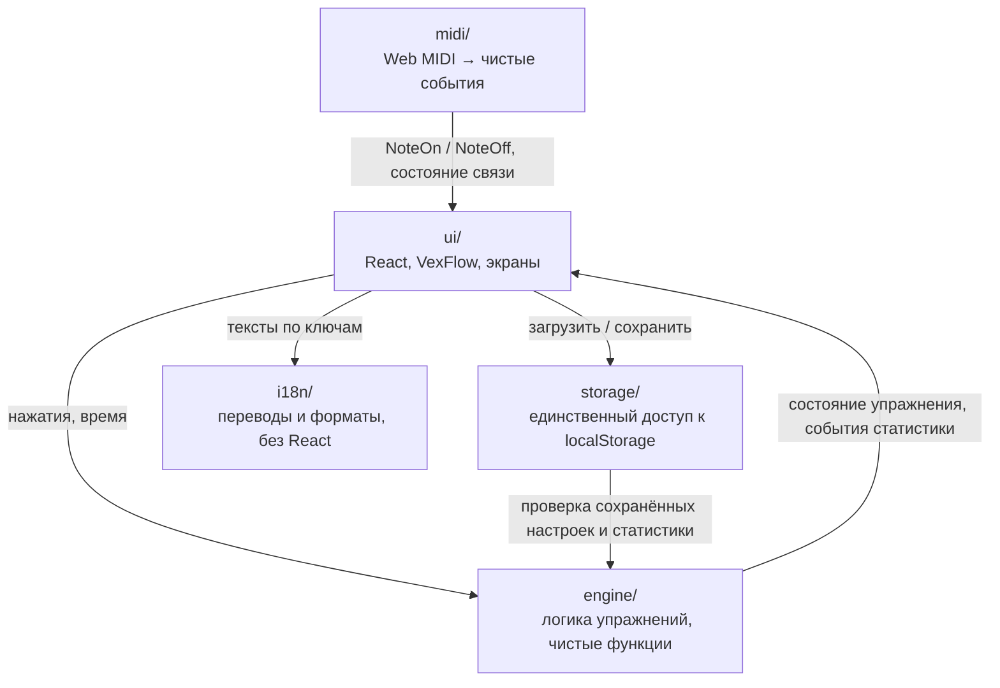

# C3. Компоненты приложения

Что внутри приложения (`src/`): слои, модули в них и зависимости. Правила слоёв — CLAUDE.md §4;
здесь — как они выполнены на деле.

## Слои

Стрелка — «пользуется». Ноты идут однонаправленно: `midi/ → ui/ (корень App) → engine/`. Слой
`ui/` — единственный, кто собирает всё вместе; `engine/`, `midi/`, `storage/` и `i18n/` о React
не знают.

| Слой | Пользуется | Не пользуется |
|---|---|---|
| `midi/` | только Web MIDI API браузера | ничем из приложения |
| `engine/` | `midi/noteNames.ts` (имя ноты по номеру MIDI) | React, Web MIDI, `localStorage`, `i18n/` |
| `storage/` | `engine/` (функции чтения настроек и статистики, значения по умолчанию), `midi/types.ts` | React, `ui/` |
| `i18n/` | ничем | React, `engine/`, `midi/` |
| `ui/` | всеми слоями | сырым Web MIDI и `localStorage` напрямую |

Две детали, которые важно знать:
- **Проверка сохранённых данных живёт в `engine/`.** Каждый модуль настроек режима
  (`engine/*/settings.ts`) сам знает свои значения по умолчанию и как прочитать сохранённое
  (`readSequenceSettings` и подобные); `storage/` их вызывает. Так новый режим приносит свои
  настройки вместе с собой, а `storage/` только собирает запись.
- **`engine/` берёт из `midi/` одну чистую функцию** — `pitchToNoteName` (имя ноты для
  статистики). Сырого MIDI в ней нет.

## `midi/` — пианино

| Файл | Что делает |
|---|---|
| `types.ts` | Публичный контракт: `ConnectionState` (7 состояний связи), `NoteOnEvent`, `NoteOffEvent`, `MidiMonitor` |
| `midiAccess.ts` | `startMidiMonitor`: запрос доступа, слушает ровно один вход, пересматривает входы на каждый `statechange`, переоткрывает вход при возврате приложения на экран, тихо повторяет запрос каждые 5 с, пока MIDI занято другим приложением, отпускает «зависшие» ноты при потере входа |
| `messages.ts` | `parseMidiMessage`: три байта → note-on / note-off; velocity 0 = note-off; канал не важен; всё остальное — `null` |
| `inputChoice.ts` | Какой вход слушать: выбор ученика по id, затем по имени (на Android id меняется), иначе первый |
| `noteNames.ts` | Номер MIDI → «C4» |

Подробно поведение — `openspec/specs/midi-input`, `connection-status`.

## `engine/` — логика

Каждое упражнение — **автомат на чистых функциях**: состояние + событие + текущее время →
новое состояние. Время передаётся параметром, поэтому всё проверяется тестами без ожидания.
Таймеров и `requestAnimationFrame` в `engine/` нет — их держат хуки в `ui/`.

| Модуль | Что внутри | Спецификации |
|---|---|---|
| `keyboard/` | `reduce` — единственное место, где меняется состояние клавиш (пианино + касания, «пианино главнее»); раскладка 88 клавиш; уровень силы нажатия; `availability.ts` — показана ли клавиатура и «есть ли чем играть» | `C-KBD-1`, `C-APP-5` |
| `modes/` | Список режимов (порядок = порядок в меню), режим по умолчанию; автомат меню режимов с черновиком настроек | `C-MODE-1` |
| `staff/` | «Разминка»: нота едет к ключу, верно / неверно, пауза, итог; подбор ноты по весам | `C-STF-1`, `C-STF-4` |
| `warmup/` | Настройки «Разминки»: время хода, ключ, диапазоны по ступеням, 15 тональностей, бекар | `C-STF-9` |
| `sequences/` | «Последовательности» и «Контур» одним автоматом (проверка `notes` или `contour`); генератор; опорные ноты и интервалы; уровни гаснущих подсказок | `C-STF-2`, `C-STF-3`, `C-STF-5` |
| `rhythm/` | «Ритм»: фигуры по уровням, генератор тактов, оценка по темпу самого ученика | `C-STF-6` |
| `solfege/` | Ядро сольфеджио: задание (ответ-нота или ответ-значение), проверка, ход сессии, выбор типов заданий, событие статистики. Режимы — подпапки `intervals/`, `durations/`: только содержание (генератор, таблица «клавиша → ответ», настройки) | `C-SOL-1`…`C-SOL-3` |
| `stats/` | Статистика по режимам: счётчики и среднее время по нотам, интервалам, фигурам, типам заданий; трудность и веса («трудное чаще»); «Что улучшилось»; события из результатов упражнений | `C-STF-4`, `C-STF-7` |
| `noteEcho/` | Карточки нажатых нот: описание ноты, пять слотов, угасание | `C-STF-8` |

Связи внутри `engine/`: `stats/` — общая для всех режимов; `solfege/` берёт отсчёт автоперехода
из `sequences/`; `sequences/` берёт у `staff/` окно аккорда (50 мс) и тип ключа.

## `storage/` — данные на устройстве

| Файл | Что делает |
|---|---|
| `browserStorage.ts` | Единственное обращение к `localStorage`; если браузер его не даёт — `null`, приложение работает без памяти |
| `settings.ts` | `piaono.settings.v1`: тип `Settings`, чтение по полям (битое поле → значение по умолчанию), запись целиком |
| `progress.ts` | `piaono.progress.v1`: уровни подсказок и статистика; запись одной части читает и сохраняет остальное |
| `backup.ts` | Резервная копия: собрать файл, проверить оболочку и формат, заменить оба ключа |

Ошибки записи молчат: упражнение важнее памяти. Подробно — [Данные](<Данные.md>).

## `i18n/` — языки

| Файл | Что делает |
|---|---|
| `locales/<язык>.ts` | Один файл на язык (`en`, `ru`); новый файл попадает в список языков без правки кода |
| `registry.ts` | Список языков из файлов, английский обязателен |
| `translate.ts` | Текст по ключу, подстановка `{name}`, формы числительных; чего нет в переводе — из английского |
| `resolveLanguage.ts` | Выбор ученика → язык системы → английский |
| `format.ts` | Секунды, даты, проценты по языку |

## `ui/` — экраны и отрисовка

**Корень — `App.tsx`.** `App` держит настройки и язык и пересоздаёт `Main` после восстановления
из копии. `Main` — точка сборки всего приложения:
- владеет **единственной подпиской на MIDI** и состоянием клавиатуры — переходы между экранами
  связь не трогают;
- `handleKeyInput` — **единая точка входа нот** с пианино и с экрана: после `reduce` сыгранная
  нота идёт во все сессии сразу, меняет состояние только та, что идёт;
- `startMode` — **единственная точка запуска** упражнения (не запускает, если «нечем играть»);
- пишет статистику и уровни подсказок, когда в сессии появились новые события.

Экраны (`Screen`): главный, «Настройки», «Проверка пианино», «Прогресс». Уход с главного экрана
останавливает упражнение без итога.

| Папка / файл | Что внутри |
|---|---|
| `topbar/` | Верхняя панель: статус связи, «Прогресс», «Настройки», «Обновить», язык |
| `settings/` | «Настройки» по группам (бар справа); группа «Копия»; строка «Версия» по дате сборки |
| `CheckScreen.tsx` | «Проверка пианино»: входы, журнал нот, ошибка доступа |
| `ConnectionStatus.tsx`, `connectionTexts.ts` | Индикатор «пианино на связи» и тексты всех состояний |
| `WaitingScreen.tsx`, `PlayInvite.tsx` | Главный экран вне упражнения; приглашение, когда нечем играть |
| `modes/` | Меню режимов и экран режима с настройками |
| `keyboard/` | Экранная клавиатура с мини-клавиатурой, легендой, отметками ✓ / ✗, границами; запросы сдвига |
| `staff/` | Общая геометрия стана (линии толще дефолта VexFlow), «Разминка»: `useExercise` — цикл кадров вокруг автомата |
| `warmup/` | Форма настроек «Разминки» и два стана-предпросмотра |
| `sequences/`, `rhythm/`, `solfege/` | Для каждого режима: хук сессии (таймеры, отсчёт), стан, итог, форма настроек |
| `solfege/views.ts` | Вид режима сольфеджио — одна запись на режим: рисунок, отметки, сдвиг, легенда, границы |
| `stats/`, `progress/` | «Ещё нет прогресса», «Что улучшилось», итог «Разминки»; экран «Прогресс» со сбросом |
| `echo/` | Полоса нажатых нот под станом |
| `hints/` | Кнопка «?» и одно окно на всё приложение; все подсказки — записи в `hints.ts` |
| `i18n/` | `I18nProvider`, `useT()`; смена языка не пересоздаёт экраны и связь |
| `controls/`, `icons/`, `ConfirmDialog.tsx`, `ScreenHeader.tsx` | Общие элементы: переключатели, ползунки, значки, «Да / Нет», шапка экрана |
| `screen/` | Компактный экран: порог в CSS-пикселях (ниже 560 по высоте или 960 по ширине) |
| `useAppUpdate.ts` | Новая версия готова → кнопка «Обновить» |

Общие механизмы, которые надо переиспользовать, перечислены в CLAUDE.md §4.

**Отрисовка нот.** VexFlow (`vexflow/bravura`) используется только в файлах `*Drawing.ts`:
`ui/staff/`, `ui/sequences/`, `ui/rhythm/`, `ui/solfege/`, `ui/warmup/`. Нотные примеры в
подсказках (`ui/hints/HintNotes.tsx`) рисуются теми же функциями.
Стан перерисовывается по ключу рисунка, а не на каждый кадр.
