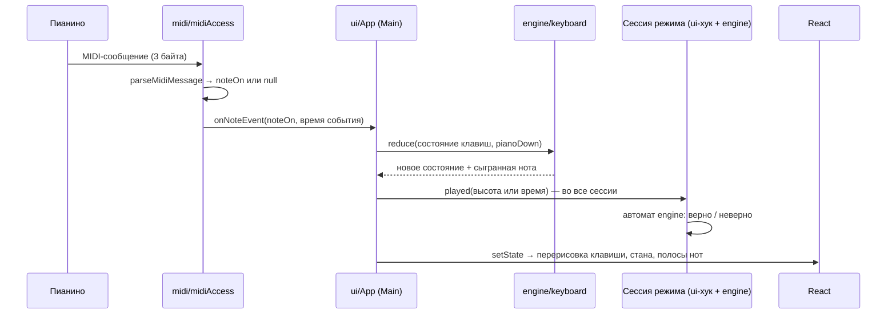
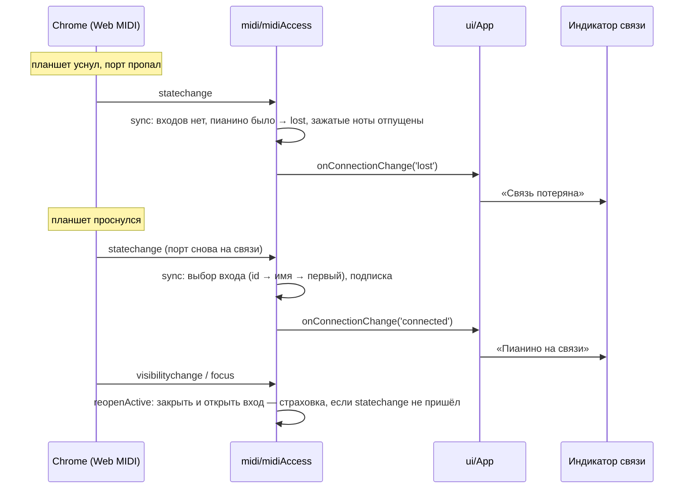
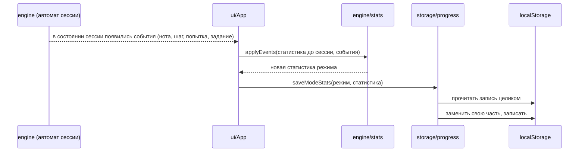
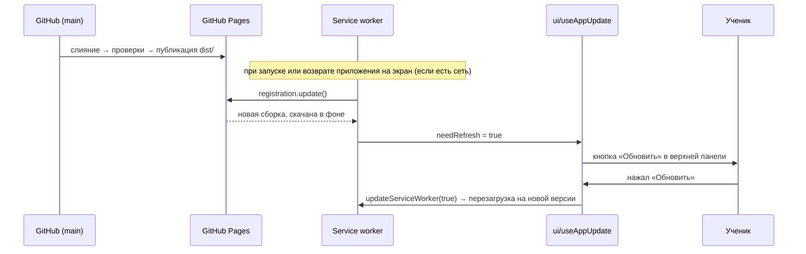

# Сценарии

Как данные идут через слои в главных путях. Подробности поведения — в спецификациях OpenSpec,
названных в каждом сценарии.

## 1. Сыграл ноту → отклик на экране

Бюджет — отклик за ≤ ~50 мс (CLAUDE.md §5). Путь короткий и без ожиданий: ни одного таймера,
сети или записи на диск между нажатием и перерисовкой.

- Касание экранной клавиатуры входит в тот же `handleKeyInput` (`touchDown` вместо `pianoDown`):
  дальше ноты с пианино и с экрана неотличимы.
- Время — это момент самого события (MIDI `timeStamp` или касания), а не момент обработки:
  «Ритму» нужно точное время удара.
- Нота идёт во все сессии сразу, но меняет состояние только та, что сейчас идёт.
- Последнее состояние клавиш держится в `ref`: события приходят чаще кадров, и ждать рендера нельзя.
- Ошибка в обработчике ноты не обрывает приём следующих (`emitNote` ловит исключения).

Контракт: `midi-input`, `piano-keyboard`, режимы — `staff-exercise`, `sequences-mode`, `rhythm-mode`,
`solfege-tasks`.

## 2. Планшет уснул и проснулся

Связь восстанавливается сама, ученик ничего не нажимает (CLAUDE.md §5).

- `lost` отличается от `no-device`: пианино было на связи в этой сессии.
- Если доступ к MIDI есть, а система его не дала (пианино держит другое приложение) — состояние
  `unavailable` и тихий повтор запроса каждые 5 с.
- Если Chrome запомнил неудачу запуска MIDI, помогает только перезапуск страницы — кнопка
  переподключения в «Настройках» (`restartApp` в `ui/App.tsx`).

Контракт: `connection-status`, `midi-input`.

## 3. Запись прогресса

- Статистика пишется сразу по ходу сессии, а не в конце: «Стоп» или потеря связи ничего не теряют.
- Статистика до сессии (`before`) берётся при «Старт»; к ней прибавляются события сессии. Так же
  «Что улучшилось» сравнивает сессию с историей до неё.
- Уровни подсказок пишутся, когда закончилась последовательность.
- Статистика сольфеджио пишется в режим заданий сессии, а не в активный режим (`C-SOL-1`, INV-5).
- Запись одной части не стирает другую; ошибка записи молчит (CLAUDE.md §7).

Контракт: `practice-stats`, `interval-hints`, `solfege-tasks`.

## 4. Новая версия приложения

Без нажатия новая версия включится при следующем запуске. Сама страница не перезагружается
никогда. Контракт: `pwa-shell`.

## 5. Резервная копия: сохранить и вернуть

```mermaid
sequenceDiagram
    participant U as Ученик
    participant G as ui/settings/BackupGroup
    participant B as storage/backup
    participant L as localStorage
    participant A as ui/App

    U->>G: «Сохранить копию»
    G->>B: createBackup(сейчас)
    B->>L: прочитать настройки и прогресс
    B-->>G: имя файла с датой, JSON
    G->>U: скачать или «Поделиться»
    U->>G: «Вернуть из файла», выбрал файл
    G->>B: readBackup(текст): метка приложения, версия формата, дата
    G->>U: «Да / Нет»
    U->>G: «Да»
    G->>A: onRestoreBackup(копия)
    A->>B: restoreBackup: прогресс, затем настройки, при сбое прогресс возвращается
    A->>A: Main пересоздаётся (новый key) и читает всё заново, включая связь с пианино
```

Контракт: `progress-backup`.
